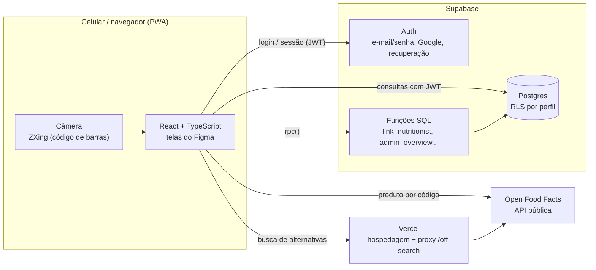

# 3. Arquitetura

## Visão geral

O NutriDecifra é uma **SPA** (aplicação de página única) em React. Não existe um servidor próprio: o navegador fala
direto com dois serviços.

- **Supabase:** autenticação e banco Postgres. A segurança fica no próprio banco (RLS e funções), então o navegador
  só usa a chave pública.
- **Open Food Facts:** base aberta de produtos, consultada pelo código de barras.



## Tecnologias

| Camada | Tecnologia | Por quê |
|---|---|---|
| Interface | React 19, TypeScript, Vite | Componentes, tipagem estática, build rápido |
| Estilo | Tailwind CSS 4 (cores do Figma em `src/index.css`) | Fidelidade ao Figma com classes utilitárias |
| Ícones | Lucide (SVG) + 2 ícones próprios (colher e saleiro) | Ícones de interface padrão, nítidos em qualquer tela |
| Rotas | React Router 7 | Rotas por tela e proteção por perfil |
| Câmera | ZXing | Leitura de EAN-13, EAN-8 e UPC no navegador |
| Backend | Supabase (Auth + Postgres + RLS) | Login seguro e regras de acesso dentro do banco |
| Dados de produtos | Open Food Facts | Base aberta, colaborativa e gratuita |
| PWA | vite-plugin-pwa | Instalação na tela inicial |
| Qualidade | oxlint, Vitest | Lint e testes automatizados |
| Hospedagem | Vercel | Publicação a cada `git push` |

## Estrutura de pastas

```
src/
  App.tsx            rotas e proteção por perfil (RequireAuth)
  context/           sessão, perfil e dados do usuário logado
  screens/           uma tela por arquivo
  components/
    ui.tsx           barra inferior, botões de voltar, selo de nota, interruptor...
    icons.tsx        ícones de categoria, de alerta, colher e saleiro
    staff.tsx        moldura das áreas do Nutricionista e do Administrador
    PasswordInput    campo de senha com o ícone de olho
  lib/
    nutrition.ts     cálculos (colheres, cota, alertas)       + nutrition.test.ts
    gamification.ts  níveis, sequência, conquistas, desafio   + gamification.test.ts
    roles.ts         perfis e qual tela cada um abre           + roles.test.ts
    care.ts          vínculo paciente ↔ nutricionista
    admin.ts         indicadores e gestão de perfis
    actions.ts       gravações no banco (leitura, salvar, trocar)
    off.ts           consultas ao Open Food Facts
supabase/migrations/ scripts do banco (001 estrutura, 002 perfis e permissões)
scripts/             seed-demo.mjs (contas de demonstração), make-icons.mjs (ícones do PWA)
docs/                esta documentação
```

## Rotas e telas por perfil

| Rota | Tela | Perfil |
|---|---|---|
| `/` | Splash | público |
| `/boas-vindas` | Onboarding | público |
| `/entrar`, `/cadastrar` | Login e Cadastro | público |
| `/recuperar-senha` | Esqueci minha senha | público |
| `/redefinir-senha` | Nova senha (link do e-mail) | público |
| `/inicio` | Home | Consumidor |
| `/scanner`, `/analisando/:codigo` | Scanner e Analisando | Consumidor |
| `/resultado/:id` | Resultado | Consumidor |
| `/alternativas/:id`, `/alternativas/:id/:codigo` | Alternativas e Detalhe | Consumidor |
| `/salvo`, `/historico` | Produto salvo e Histórico | Consumidor |
| `/alertas`, `/alertas/personalizar` | Alertas e Personalizar alertas | Consumidor |
| `/perfil`, `/planos`, `/conquistas`, `/acessibilidade` | Perfil, Planos, Gamificação, Acessibilidade | Consumidor |
| `/profissional` | Meus pacientes | Nutricionista |
| `/profissional/paciente/:id` | Ficha do paciente | Nutricionista |
| `/admin` | Painel do administrador | Administrador |

Se alguém abre uma rota de outro perfil, o `RequireAuth` manda essa pessoa para a própria tela inicial. Isso é só a
navegação: mesmo que alguém force uma consulta, o banco bloqueia pela RLS (veja o documento 05).

## Fluxo de uma leitura

```mermaid
sequenceDiagram
  actor C as Consumidor
  participant App
  participant OFF as Open Food Facts
  participant DB as Supabase
  C->>App: aponta a câmera
  App->>App: ZXing lê o código de barras
  App->>OFF: GET produto pelo código
  OFF-->>App: nutrientes, alérgenos, Nutri-Score
  App->>App: calcula colheres, cota e alertas (perfil do usuário)
  App->>DB: insert em scans e alerts (RLS: user_id = auth.uid())
  App-->>C: tela de Resultado
```
