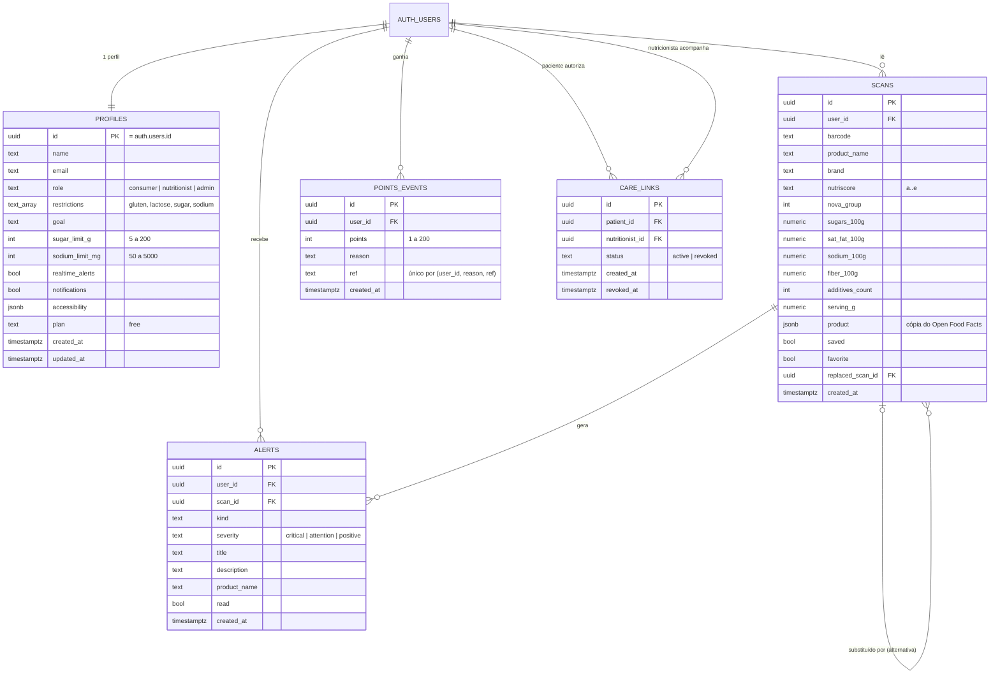

# 4. Banco de dados

Postgres hospedado no Supabase. Os scripts ficam em `supabase/migrations/` e devem ser rodados **nesta ordem** no SQL
Editor do Supabase:

1. [`001_init.sql`](../supabase/migrations/001_init.sql): tabelas, índices, RLS de cada usuário, gatilhos.
2. [`002_perfis_e_permissoes.sql`](../supabase/migrations/002_perfis_e_permissoes.sql): perfis de acesso, vínculo
   paciente ↔ nutricionista, RLS por perfil e funções (RPC).

Os dois podem ser rodados de novo sem quebrar nada. Se você rodar o 001 de novo, rode o 002 em seguida, porque o 002
restringe as permissões que o 001 concede.

## Modelo entidade-relacionamento

## Dicionário de dados

### `profiles`: um registro por conta
Criado automaticamente no cadastro pelo gatilho `on_auth_user_created`.

| Coluna | Tipo | Descrição |
|---|---|---|
| `id` | uuid (PK, FK → auth.users) | Identificador da conta |
| `name`, `email` | text | Nome exibido e e-mail |
| `role` | text | Perfil de acesso: `consumer` (padrão), `nutritionist`, `admin` |
| `restrictions` | text[] | Restrições marcadas: `gluten`, `lactose`, `sugar`, `sodium` |
| `goal` | text | Objetivo: `reduce_sugar`, `reduce_sodium`, `eat_better`, `avoid_ultra` |
| `sugar_limit_g` | int | Limite diário de açúcar (padrão 25 g) |
| `sodium_limit_mg` | int | Alerta de sódio por porção (padrão 400 mg) |
| `realtime_alerts`, `notifications` | bool | Preferências de aviso |
| `accessibility` | jsonb | Texto maior, contraste, voz, menos animação, linguagem simples |
| `plan` | text | Plano (`free`; o Premium ainda não está à venda) |

### `scans`: cada produto lido
| Coluna | Descrição |
|---|---|
| `barcode`, `product_name`, `brand`, `quantity`, `image_url` | Identificação do produto |
| `nutriscore`, `nova_group` | Nota A–E e grupo NOVA (1–4) |
| `sugars_100g`, `sat_fat_100g`, `sodium_100g`, `fiber_100g`, `additives_count`, `serving_g` | Valores usados nas análises e nos resumos |
| `product` | Cópia dos dados do Open Food Facts no momento da leitura |
| `saved`, `favorite` | O usuário salvou ou favoritou |
| `replaced_scan_id` | Quando o produto foi escolhido como alternativa a outro |

### `alerts`: avisos gerados para o perfil
`kind` = `gluten`, `gluten_traces`, `lactose`, `lactose_traces`, `sugar`, `daily_sugar`, `sat_fat`, `sodium`, `additives`,
`good_choice`. `severity` = `critical`, `attention`, `positive`.

### `points_events`: pontos da gamificação
A restrição `unique (user_id, reason, ref)` garante que a mesma ação nunca pontua duas vezes. O usuário pode inserir
pontos (até 200 por evento), mas não pode editá-los nem apagá-los.

### `care_links`: autorização paciente → nutricionista
| Coluna | Descrição |
|---|---|
| `patient_id` | Consumidor que autorizou |
| `nutritionist_id` | Nutricionista autorizado |
| `status` | `active` (pode ver) ou `revoked` (acesso retirado) |
| `revoked_at` | Quando o acesso foi retirado |

Um par paciente–nutricionista só existe uma vez (`unique`). Ninguém pode se vincular a si mesmo.

## Funções (RPC)

| Função | Quem chama | O que faz |
|---|---|---|
| `link_nutritionist(email)` | Consumidor | Autoriza o nutricionista com esse e-mail |
| `my_nutritionists()` | Consumidor | Lista quem ele autorizou (nome e e-mail) |
| `admin_overview()` | Administrador | Números agregados da plataforma |
| `admin_set_role(usuario, perfil)` | Administrador | Muda o perfil de uma conta (nunca a própria) |
| `is_admin()`, `is_my_patient(id)`, `current_app_role()` | Políticas RLS | Funções auxiliares das regras de acesso |

As funções são `security definer` com `search_path` vazio e conferem o perfil de quem chama antes de agir.

## Gatilhos

- `on_auth_user_created`: cria o `profile` quando alguém se cadastra.
- `profiles_touch`: atualiza `updated_at` a cada alteração do perfil.
